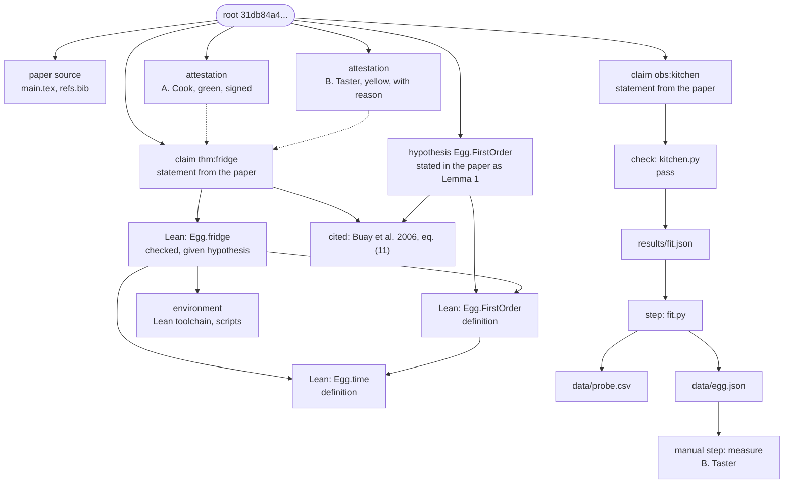

# trust-ledger

A tamper-evident record of what each result in a paper rests on: machine-checked proofs, scripts and data,
cited results, reports by people, model-generated aids, and the named people who vouch for each statement.
One root hash, printed in the paper, seals all of it.

Status: alpha, version 0.2.0 (ledger format 0.2.0). Formats and commands may still change. The method is
described in a paper in preparation.

## Why

Suppose you wrote a paper with the help of an AI model. The model suggested two of the lemmas and wrote most
of the proofs in [Lean](https://lean-lang.org). Lean is a proof assistant: a program in which a mathematical
statement and its proof are written down so precisely that the computer checks every step, and a proof it
accepts has no gap. A script the model drafted fits the data and draws the figures. A colleague repeated the
experiment in their own lab and sent you a short report. Now you want to be honest with your readers, in a
way they can check: what did a machine verify, what did a person observe, what came out of a model, and who
stands behind each result?

Or, with no AI involved: a master's thesis whose results come out of a data analysis, whether of lab
measurements, geological drill cores, GIS layers, a psychology study or a survey in experimental philosophy.
There are raw data, a cleaning script, an analysis that produces the tables and maps, perhaps interviews that
must not be published, and a supervisor who asks: which version of the data produced Table 3? Was the
exclusion rule fixed before anyone looked at the results? Does Figure 5 still come from the current script?

The pieces do not answer this by themselves. Lean checks a proof no matter who wrote it, but it cannot tell
whether the formal statement says what the sentence in the paper says. A script reproduces a figure, but not
the measurement behind it, and a folder of data files does not say which of them a table was computed from.
A model's summary of a proof is not a review. trust-ledger keeps these apart and writes them down:

* **computed**: what a tool derived and anyone can recompute: Lean declarations with their axioms and any
  `sorry` (Lean's marker for a proof step left out), results of [ProVerif](https://bblanche.gitlabpages.inria.fr/proverif/)
  (a verifier for security protocols), results of check scripts, digests of data and figure files.
* **asserted**: what a person wrote: the claims, results cited from other papers, statements made without
  proof, manual steps with the name of the person who did them (a measurement, a tester's report), and
  private data, which enters only as a salted commitment.
* **generated**: what a model produced, such as a back-translation of a Lean statement into prose, or an
  assessment of whether paper and formal statement agree. These are part of the record, but they never count
  as an attestation and never enter the hash of a statement.
* **attestations**: a named person states that they checked a result against its evidence, at a level
  (green, yellow, conjecture), optionally signed with their ssh key. An attestation is bound to the exact
  statement. If the statement or a definition it uses changes, the attestation is shown as *stale*, and it is
  not silently carried over.

The ledger does not record who wrote which sentence of the prose; say that in the paper. It records what a
reader cannot see from the text: what each result rests on, and who has checked it.

## How it works

Every item gets a hash computed from its exact content and from the hashes of everything it rests on.
Together they form a Merkle DAG with a single root. Change one character anywhere (a data file, a definition,
a theorem in the paper, an attestation) and the root changes. The root is printed in the paper's appendix,
next to a table with the status of every result, and can be published elsewhere too, for example in the
arXiv comment field. Anyone with the supplementary files can recompute it with `ledger.py verify`.

Part of the ledger of the example paper in `examples/egg` (solid arrows: "rests on"; dotted: an attestation
is bound to the statement of a claim):



A figure works the same way as `results/fit.json`: the script that draws it is a step, the image is its
output, and `ledger.py reproduce` re-runs the step in a scratch copy and compares.

## An example: how long to boil an egg

`examples/egg` is a four-page paper ([PDF](examples/egg/paper/main.pdf)) based on Buay et al., *How long does it
take to boil an egg? Revisited*, Eur. J. Phys. 27 (2006) 119. It has Lean proofs, a cited formula used as a
hypothesis, kitchen data with a fit and a check, tasting notes behind a commitment, a conjecture, and
attestations of every kind. The kitchen and its people are fictitious. Its appendix is generated by the
ledger. On the command line:

```
$ cd examples/egg && python3 ../../ledger.py -P egg status
claim    evid  stmt  lean                      checks  attestation                                      register
colder   E1    tex   ok                        -       GREEN B. Taster STALE                            0
fridge   E1    tex   assumes (1/1 known thm.)  -       GREEN A. Cook current; YELLOW B. Taster current  2
kitchen  E4    tex   -                         pass    GREEN A. Cook current                            2
scaling  E1    tex   ok                        -       GREEN A. Cook current; GREEN C. Reader current   0
six      E5    tex   -                         -       CONJECTURE A. Cook current                       2
taste    E5    tex   -                         -       GREEN B. Taster current                          1

hypotheses (results are proved given these):
  Egg.FirstOrder  [lem:firstorder; cites buay]  GREEN A. Cook current

root 31db84a49ec79cf2203212c59d6b641aa328045338efdc321a905a1738b159c7  (paper egg)
```

B. Taster's attestation of `colder` is stale: it was given for an earlier, weaker version of the lemma. The
*register* column counts what a result rests on that no machine checked (here a hypothesis and a citation,
data taken as given, a manual step, an assertion). `python3 ../../ledger.py -P egg why fridge` lists it all,
and `make` rebuilds the paper.

Three smaller examples: `examples/toy` (Lean and ProVerif, the test fixture), `examples/lab` (a pendulum
measurement with a manual calibration step and private notes) and `examples/prereg` (a fictitious
preregistered study, with its own evidence types and checklist and a recorded deviation from the plan).

## What it does not do

It does not prove anything correct, and it does not decide whether a formal statement means what the text
means. That is the job of the people who attest, and an attestation is only as good as the person who gives
it. There is no certificate authority: a key is bound to a person by being published with the root under the
authors' names. What the ledger guarantees is narrower: the record cannot be changed afterwards without the
root changing, and a statement cannot be changed without its attestations going stale.

## Getting started

`ledger.py` is the whole tool: one file, Python 3.11 or later, standard library only. Copy it into your
project and create `ledger/ledger.toml` and `ledger/claims.toml` (see `examples/egg/ledger/`). Some
commands call external programs: `extract` runs your adapters (Lean, ProVerif), `review` needs `latexmk` and
`pdflatex`, signatures need `ssh-keygen`. `status`, `why`, `lock` and `verify` need nothing else.

What is in this repository:

* `ledger.py`: the tool.
* `docs/FORMAT.md`: the normative format (hashing, node kinds, register). Another implementation should
  reproduce the same hashes.
* `docs/ARCHITECTURE.md`: what is fixed in the core and what varies by field; how to add an adapter.
* `adapters/`: programs that turn a tool's output into the generic adapter dump (`docs/FORMAT.md` 2.6):
  `lean.py` (Lean, via `lean/Dump.lean`) and `proverif.py`. An adapter can be written in any language.
  `dvc_steps.py` turns the stages of a DVC pipeline into steps (needs PyYAML).
* `lean/Dump.lean`: writes out the theorems and definitions of a Lean project, the exact terms the Lean kernel
  accepted, and the axioms they use. It has been run with Lean v4.34.1, and there is no ready-made container
  for it yet.
* `tex/ledgercheck.sty`: prints the root, the status appendix and a summary paragraph in the paper.
* `examples/`: the four examples above. `tests/`: `python3 -m unittest discover -s tests`.

## Files and commands

```
ledger/ledger.toml       project config
ledger/claims.toml       claims, citations, assertions (human-written; any *.toml in ledger/ is read)
ledger/data.toml         sources, steps, checks (human-written, FORMAT.md 3.4)
ledger/NAME.json         generated by `ledger.py extract`, i.e. the extractor of [adapter.NAME]
                         (lean.json, proverif.json, ...)
ledger/attestations.toml appended by `ledger.py attest`
ledger/lock.json         generated by `ledger.py lock`; commit it
```

```
python3 ledger.py status            # claims: evidence type, Lean status, attestation, register size
python3 ledger.py why CLAIM         # what a claim rests on, who attested
python3 ledger.py attest CLAIM --person NAME --level green --checklist A1,A2
python3 ledger.py addkey ID --person NAME --pub KEY.pub     # register an ssh key (optional signatures)
python3 ledger.py attest CLAIM --person NAME --level green --sign ~/.ssh/id_ed25519 --key ID
python3 ledger.py attest CLAIM ... --out me.att.toml --pub KEY.pub   # standalone attestation file
python3 ledger.py -P NAME verify-attestation me.att.toml --lock ledger/lock-NAME.json
python3 ledger.py attest --hypothesis NAME --person NAME --level green   # "this hypothesis is a known theorem"
python3 ledger.py extract           # run the extractors of all adapters, write their dumps
python3 ledger.py check             # run the [check.NAME] commands, record their results
python3 ledger.py reproduce         # re-run the command steps in a scratch copy, compare their outputs
python3 ledger.py commitment PATH --salt-file FILE   # salted commitment for data that stays private
python3 ledger.py lock              # write lock.json, print the root
python3 ledger.py verify            # recompute, compare with lock.json
python3 ledger.py migrate --old-lock OLD.json   # after a format change: rebind attestations (FORMAT.md 6)
```

Lean: a script that runs `Dump.lean` inside the Lake project after `lake build`, piped into the converter,

```
# ledger/dump.sh (declaration names on stdin):
lake env lean --run Dump.lean module=Toy root=Toy assume=Toy.BanachProp

# ledger/ledger.toml:
[adapter.lean]
extract = "ledger/dump.sh | python3 adapters/lean.py"
```

## In the paper

`ledger.py -P NAME tex` writes `ledger-NAME-root.tex` and `ledger-NAME-status.tex` into the
`[generated]` directory (excluded from the hashed source, so the root can sit in the document it
covers). `\usepackage[paper=NAME]{ledgercheck}` then appends the appendix "Evidence ledger" (status
banner, root, explanation, how to check, table) automatically. The table has one column per tool the
paper's claims use, with the headings, texts and legends the adapters supply. Without the generated files it prints
"UNSEALED DRAFT"; without the `paper=` option it does nothing. To switch it on without touching the
paper source (e.g. in a publish script), load it at the end of the preamble; a plain
`\RequirePackage` before `\documentclass` collides with classes that define `\toprule`:

    pdflatex '\AddToHook{begindocument/before}{\RequirePackage[paper=NAME]{ledgercheck}}\input{main}'

For the paper's own text, `\ledgersummary[heading]` typesets one paragraph from the same files: how many
results are machine-checked and by which tool, under which hypotheses (and who attests them as known
theorems), what is not in the ledger, who attested what and whether it is signed, the short root with the
full hash in a footnote, and where to find the rest (the appendix if the build has one, else the supplement).
A paper that uses it loads `\usepackage{ledgercheck}` itself, without options, so drafts and a submission
without the ledger show nothing; a publish script switches it on with
`\PassOptionsToPackage{paper=NAME,auto=0}{ledgercheck}` before the class (summary only) or `paper=NAME`
(summary and appendix):

    pdflatex '\PassOptionsToPackage{paper=NAME,auto=0}{ledgercheck}\input{main}'

The table uses plain `tabular`s in chunks because `longtable`, `supertabular` and `p`-columns fail in
the two-column `quantumarticle` class.

## Review packets

`python3 ledger.py -P NAME review` builds a PDF for the person who is about to attest: for every claim of the paper,
the statement **typeset in the paper's own macros with the paper's numbers and page** (an equation comes with its
paragraph and the paragraph before it), the model-generated back-translation of the Lean statement, an optional
model-written assessment (`ledger/assessments.toml`) and the Lean text. It builds the paper once in a scratch
directory for its `.aux`, so it never touches your build files, and it needs `latexmk` and `pdflatex`.
Configure it with a `[review]` table (`readings`, `extracts`, `skip_envs` for reading aids such as explainer boxes).
The Lean definitions of all extracts are shown once, numbered, in a section Definitions; each claim shows only its
theorem(s) and the numbers of the definitions it uses (`--defs-inline` repeats them with every claim).
Readings and assessments are generated nodes of the ledger: part of the root, never part of a statement hash.

## Validation so far

On a private research Lean project (86 registered declarations, 709 in the dependency
closure): statuses and axiom sets agree with an independent export for all 86;
the dump is byte-identical across runs. Mutation test on a leaf theorem, with the claim attested
beforehand:

| mutation | result |
|---|---|
| unused `have` added to the proof, statement unchanged | `verify` fails (proof node, claim and attestation hashes changed); attestation stays *current*; other claims unchanged |
| statement weakened (`<` to `≤`) and proof replaced by `sorry` | claim status `sorry`, `sorry:` entry in the register, attestation *STALE*; other claims unchanged |
